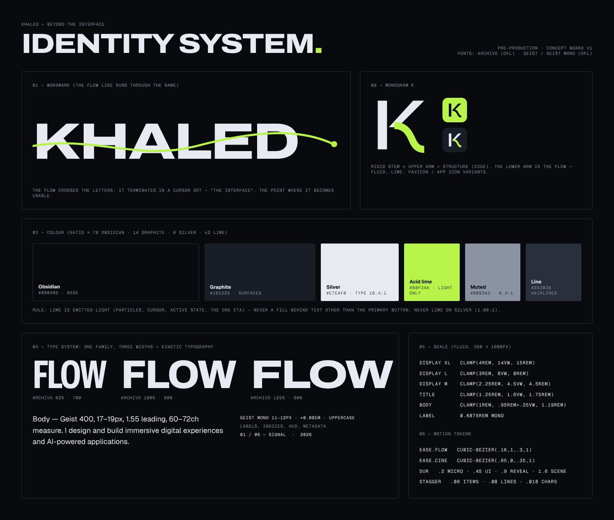
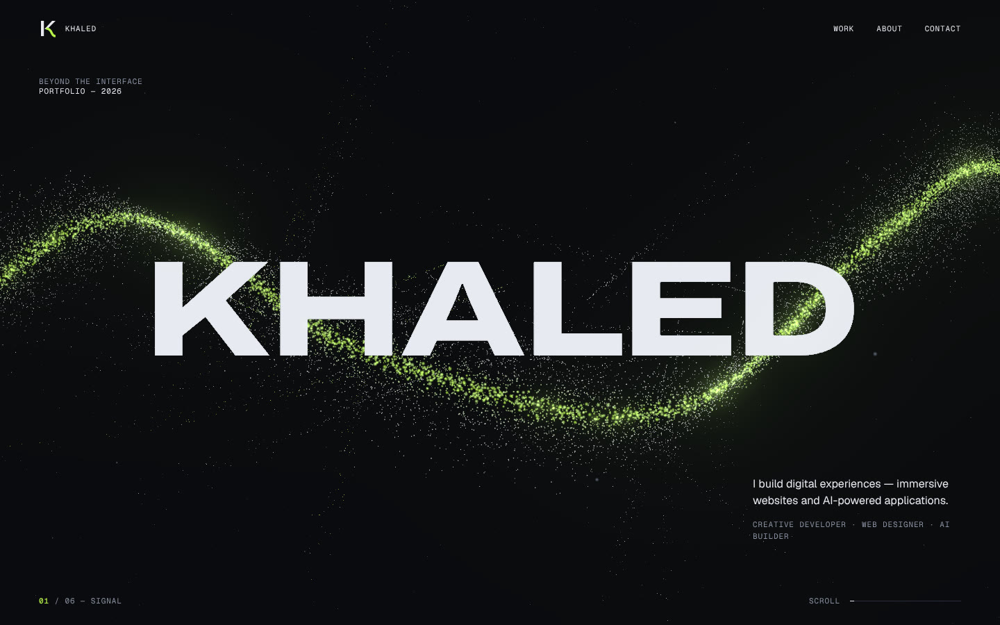
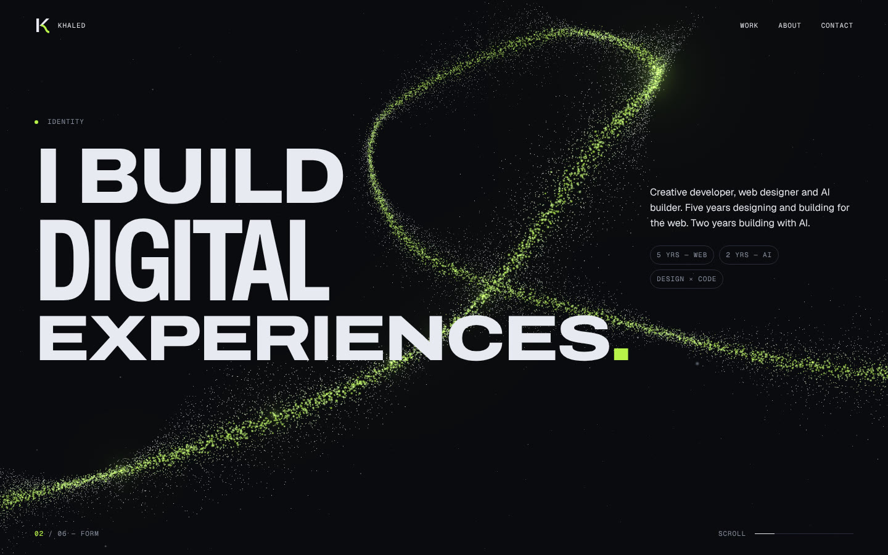
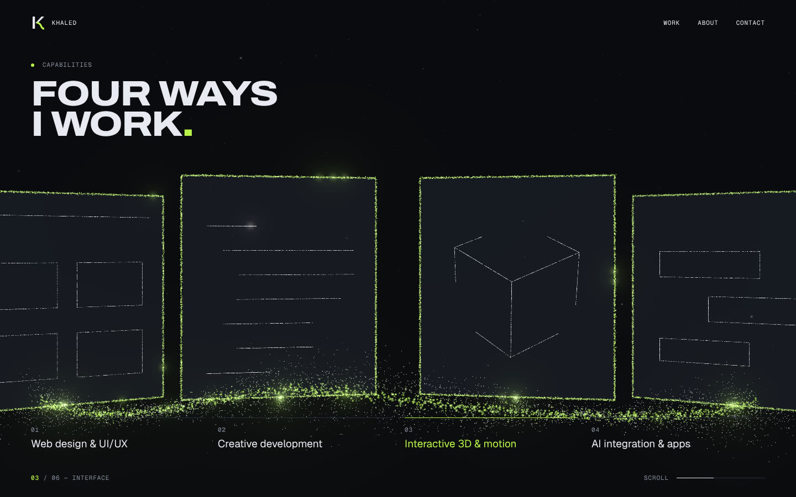
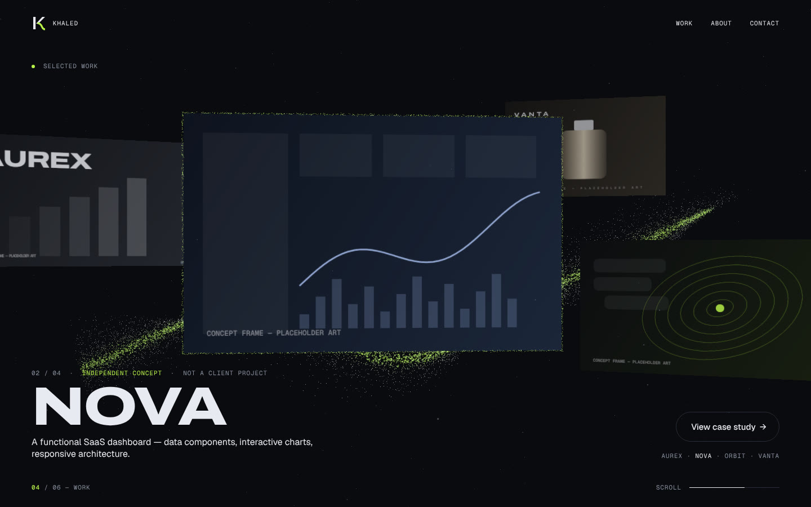
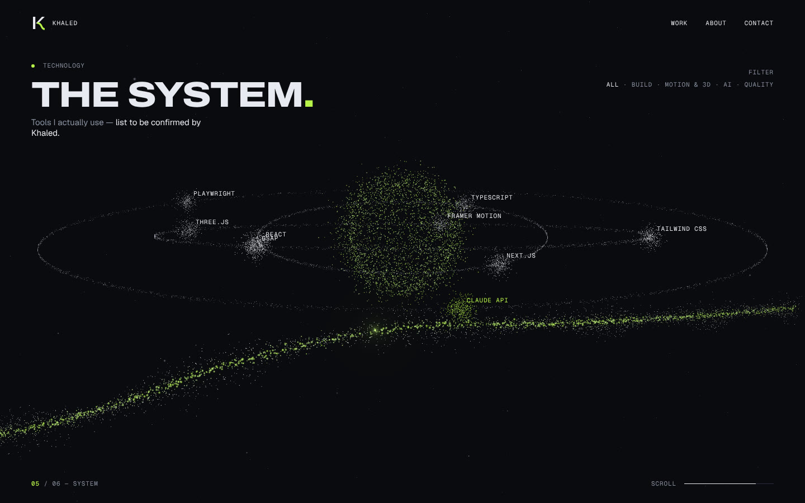
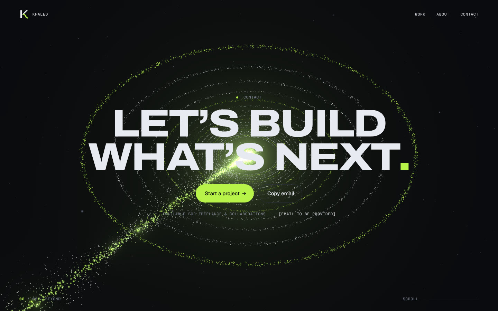
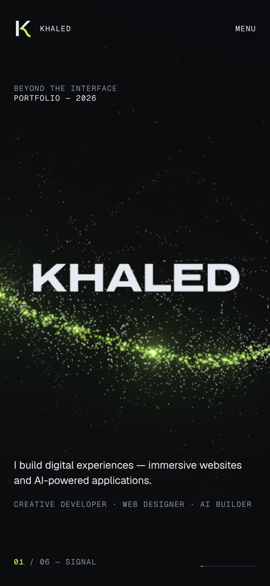
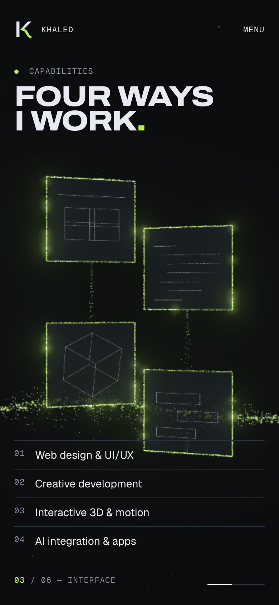
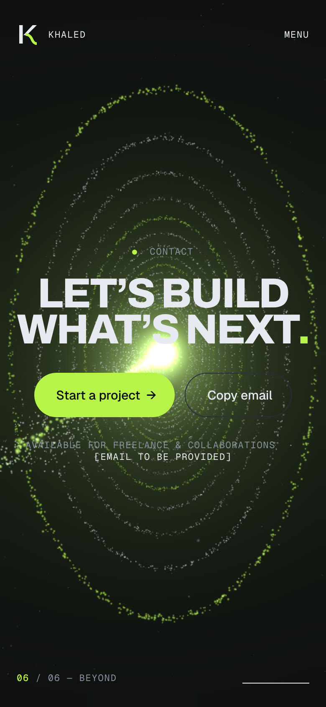

# Art Direction — KHALED · Beyond the Interface

**Status:** proposal v1, awaiting Khaled's approval · **Date:** 2026-11-24
**Companion docs:** [Storyboard & motion spec](preproduction/storyboard-motion-spec.md) · [Technical plan](preproduction/technical-plan.md) · [Reference breakdown](research/weblove-reference-breakdown.md)
**Concept frames:** rendered from a working prototype of the Digital Flow (real fonts, real palette, real particle system) in [`preproduction/frames/`](preproduction/frames/).

---

## 1. Concept

**Concept line:** *Every interface begins as a signal.*
The site follows one stream of light, **the Digital Flow**, from raw signal to finished interface. At the end, the Flow opens into a portal and invites the visitor through it: *beyond the interface*, into working together.

This is Khaled's actual story told as a single visual journey: a person who turns ideas (signal) into designed, built, intelligent products (interface). Each chapter is one step of that transformation:

| # | Chapter | What the Flow is | What the visitor learns |
|---|---|---|---|
| 01 | **Signal** | Scattered particles gathering into one luminous ribbon | Who: KHALED |
| 02 | **Form** | The ribbon finds shape, a confident sweeping form | What: "I build digital experiences." Creative developer, web designer, AI builder |
| 03 | **Interface** | The ribbon resolves *into* four interfaces | How: four ways he works |
| 04 | **Work** | Light behind and around the work | Proof: four independent concept projects |
| 05 | **System** | Orbits around a core | Tools he actually uses |
| 06 | **Beyond** | A portal you pass through | Action: start a project |

### Interpretations considered

| | Direction | Verdict |
|---|---|---|
| **A** | **Signal → Interface** (above). The Flow is abstract light that *becomes* UI. | ✅ **Recommended.** It's original, it serves the "AI builder + designer + developer" positioning, and the morph into interfaces is a signature moment nobody else has. |
| B | *Living code*: the Flow made of code glyphs and characters. | ❌ Too literal; drifts into the "Matrix rain" cliché and reads less premium. |
| C | *Light painting*: long-exposure light trails, pure art. | ❌ Beautiful, but it says nothing about interfaces or AI. Art without the professional argument. |

### Distinct from the Weblove reference (by design)

| Weblove | Khaled |
|---|---|
| Chrome chains + spiked star (heavy, physical, metal) | A particle ribbon of light (weightless, digital, luminous) |
| Light grey hero descending to dark red | Obsidian throughout; light *emerges* from darkness |
| Red + cyan two-tone, red as surfaces and panels | Silver + one signal-red accent used **only as light** (no red fills, no cyan pairing) |
| Extended wordmark cropped at the bottom | Centred wordmark *inside* the 3D space, crossed by the Flow |
| Lanyard badge finale | A portal finale |

**What we deliberately take:** the production standard, one persistent 3D motif across chapters, chapter-defining lighting, and massive type contrasted with tiny UI.

## 2. Audience & job-to-be-done

- **Primary:** founders, startups and brands who need a premium website or an AI-powered product, plus studios hiring a creative developer.
- **What they skim for:** can he make something *this* good for me? Can he actually build it, beyond just designing? Does he understand AI products? How do I contact him?
- **The site's job:** prove craft in the first 5 seconds, prove range through the four concepts, and convert via one primary CTA, **Start a project**.

### Business positioning (refinement 1, approved 2026-11-24)

The site must say **what Khaled sells, to whom** within the first viewport, without waiting for the scroll story:

- **Hero line (under the wordmark):** "Premium websites, cinematic digital experiences and AI-powered applications, designed and built for ambitious brands and founders."
- **Service strip (hero, mono):** Premium websites · Cinematic experiences · AI applications
- **Hero CTAs:** **Start a project** (primary, accent) · View work (secondary)
- "I build digital experiences." stays the Scene 02 headline, as the identity statement that follows the offer.
- The page `<title>` and meta description lead with the offer, not just the name.

**Do:** cinematic, precise, luminous, confident, technical, calm.
**Don't:** gamer/neon, cyberpunk clutter, "AI startup" gradients, glassmorphism, template-like, loud.

## 3. Typography

One display family whose **width axis is the kinetic typography**. The letters literally flow between condensed and expanded.

| Role | Face | Settings | Why |
|---|---|---|---|
| Display | **Archivo** (variable, OFL) | wght 700–800, **wdth 62 → 125**, uppercase, tracking −0.035em, leading 0.86 | One family, three voices. Width animation *is* the flow made typographic. Distinctive, and not one of the overused display defaults. |
| Text | **Geist** (variable, OFL) | 400/500, 17–19px, leading 1.55, measure 60–72ch | Precise and contemporary; reads as "developer who designs". |
| Labels / HUD | **Geist Mono** (OFL) | 11–12px, +0.08em, uppercase | Chapter index, metadata, tool names. The "interface" layer. |

**Scale (fluid 360 → 1600px):** Display XL `clamp(4rem, 14vw, 15rem)` · Display L `clamp(3rem, 8vw, 8rem)` · Display M `clamp(2.25rem, 4.5vw, 4.5rem)` · Title `clamp(1.25rem, 1.6vw, 1.75rem)` · Body `clamp(1rem, .95rem + .25vw, 1.19rem)` · Label `.6875rem`.

**Rules:** display type is never body copy. A maximum of three widths appear on one screen. Tabular numerals for indices. All fonts are self-hosted via `next/font/local`, so there are no third-party font requests.

## 4. Colour

| Token | Hex | Role | Contrast on Obsidian |
|---|---|---|---|
| Obsidian | `#090A0D` | Base (≈ 78% of pixels) | — |
| Graphite | `#191D25` | Surfaces, panels (≈ 14%) | — |
| Silver | `#E7EAF0` | Type, primary light (≈ 6%) | **16.4 : 1** |
| Signal Red | `#FF4436` | Accent **as light** (≤ 2%) — replaced Acid Lime `#B8F34A` on 2026-11-24 at Khaled's request | **5.78 : 1** (AA) |
| Muted | `#8B93A3` | Secondary text | **6.4 : 1** (AA) |
| Line | `#2A303B` | Hairlines, borders | decorative only |

**The accent rule:** the accent is *emitted light*. It appears in particles, the cursor dot, active states, the period that ends headlines, and the **one** primary button (obsidian text on red = 5.78 : 1, AA). Never use it as a decorative fill or a large surface. In the Flow, red only reads as light with a **hot near-white core and a red halo**; mixing red toward silver turns it pink. Form errors use **amber `#F2B33D`** so they can never be mistaken for the accent. In code the token is `accent`, so a future colour change is one line.

**Honest note:** red on black was also the Weblove reference's base colour. What keeps this identity distinct is the same discipline: red as light (particles, a single CTA), never as red panels or surfaces, no cyan pairing, and silver type dominant. Each concept project keeps its own colour field (cool steel NOVA, ember-dark ORBIT, warm bone VANTA, neutral stone AUREX).

All tokens ship as OKLCH in Tailwind v4 `@theme` (see the technical plan).

## 5. Logo

- **Wordmark:** KHALED in Archivo 125% / 800, crossed by the Flow line, which ends in a **cursor dot**. The signal becomes the interface (the point of interaction).
- **Monogram K:** a rigid stem + upper arm (structure, code), and a **lower arm drawn as the Flow** in the accent red (fluid, design). Used for the favicon, app icon, OG images and loader.
- **On the site:** the monogram + "KHALED" label sits top-left in the nav. In Scene 01 the 3D wordmark *is* the logo moment, with the live Flow passing through it.
- These are proposals for direction approval; final vector refinement happens in Phase 3.

## 6. Grid, space, imagery

- **Grid:** 12 columns, gutters 24px, outer margins `clamp(20px, 4vw, 56px)`; 4 columns on mobile.
- **Composition:** left-aligned editorial type plus a right-hand HUD column (mono). The 3D owns the full bleed behind. Grid breaks are reserved for the wordmark (Scene 01) and the portal (Scene 06).
- **Space:** a 4px base unit, with generous silence. One idea per viewport.
- **Imagery:** the concept projects are shown as **real screenshots and recordings of the builds we make**, never stock images or fake device mockups. In 3D they are planes in depth. In DOM they use a fixed 16:10 ratio with a clip-path reveal.
- **Texture:** a subtle film grain (≤ 7% overlay) to keep the blacks from looking digital-flat.

## 7. Motion principles

1. **Light leads.** The Flow moves first and content follows it. Nothing appears without a source.
2. **Scroll is the timeline.** Chapter changes are scrubbed and fully reversible. Scrolling back replays exactly.
3. **Continuous, never cut.** No jump cuts between sections; the Flow carries the eye from one to the next.
4. **Precise, not playful.** No bounce or elastic. Easing family: `ease.flow` = `cubic-bezier(.16,1,.3,1)` for entrances, `ease.cine` = `cubic-bezier(.65,0,.35,1)` for scene moves.
5. **Durations:** 0.2s micro · 0.45s UI · 0.9s reveals · 1.6s scene moves. Exits are 30% faster than entrances.
6. **What never moves:** body copy while it's being read, the nav, form fields.
7. **Glitch is punctuation:** at most 300ms, only on deliberate triggers (project title hover, tool-filter change), and never on body text.

The full per-scene specification (purpose, trigger, duration, exit state) is in the [motion spec](preproduction/storyboard-motion-spec.md).

## 8. Signature moments (four, no more)

1. **The formation** (Scene 01): particles gather from darkness into the ribbon, which threads *through* the KHALED wordmark.
2. **Flow → Interface** (Scene 03): the ribbon splits into four streams and *builds* four interfaces out of light.
3. **Into the work** (Scene 04 → case study): a project card expands from the 3D gallery into its case-study hero.
4. **The portal** (Scene 06): the Flow becomes a tunnel; the CTA waits at its centre.

Scenes 02 and 05 are deliberately quieter. Restraint is what makes the four land.

## 9. Pages

| Page | Hero concept |
|---|---|
| `/` Home | The six chapters above |
| `/work/[slug]` ×4 | Case study **+ showcase** (refinement 2): the project's own colour field, the Flow as a thin light line, visual showcase and **one focused functional demo where it fits** (NOVA live chart, ORBIT assistant demo, VANTA product viewer + bag, AUREX motion piece). These are not full production apps at this stage; they can be expanded later. |
| `/start` | **Start a Project** (refinement 3): a guided inquiry covering project type, budget range, timeline, description and contact details, in the portal-lite visual language |
| About | Lives in Scene 02 on the home page (story, approach, 5 years web + 2 years AI); a standalone page can come later |
| `404` | The Flow scattered: "This signal got lost." |

## 10. Reference board — principles only

| Reference | Principle taken |
|---|---|
| **Weblove** (provided video) | One persistent 3D motif across chapters; lighting changes mark chapters; massive type vs tiny UI |
| **Igloo Inc** (Awwwards Site of the Year 2024) | One coherent 3D world with UI behaving like a calm HUD over it |
| **Lusion** (studio site) | The real-time WebGL craft bar: every 3D element responds to the user |
| **Linear** (product site) | Interfaces rendered as art: fine hairlines and precise dark UI. Informs the Scene 03 panels |
| **Vercel / Geist** | Typographic precision and mono metadata as a design layer |
| **Active Theory** (studio site) | WebGL as narrative rather than decoration |

These references are from my knowledge of these sites. I haven't re-inspected them in this session; we take principles only, never assets or layouts.

**Concept frames (rendered prototype, real fonts, real particle system):**

| | |
|---|---|
|  **01 Signal** |  **02 Form** |
|  **03 Interface** |  **04 Work** |
|  **05 System** |  **06 Beyond** |

Mobile:   

*Concept frames were rendered with the original lime accent (pre 2026-11-24); live screenshots in `review/hero/screenshots/` show the current red. Project art in frame 04 is procedural placeholder, labelled as such. It will be replaced by real captures of the four builds.*

## 11. Risks

| Risk | Mitigation |
|---|---|
| Spectacle overwhelms the work | Four signature moments only; projects get their own colour fields; the work is shown large |
| Mobile performance | Particle tiers (30k → 8k → static poster), no postprocessing on mobile; see the technical plan |
| Accessibility of a 3D-first site | Full DOM content layer, reduced-motion mode, keyboard-complete; the canvas is decorative |
| Similarity to the reference (red on black) | The accent-as-light rule; no red surfaces; silver dominant; per-project colour |
| Content gaps | See the "Inputs needed" list; nothing is invented, and placeholders are explicit |
