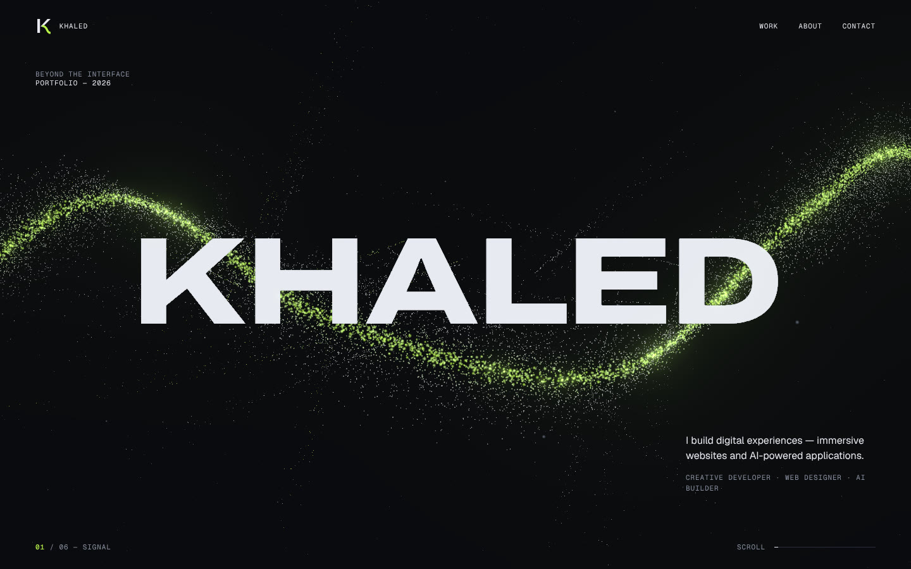
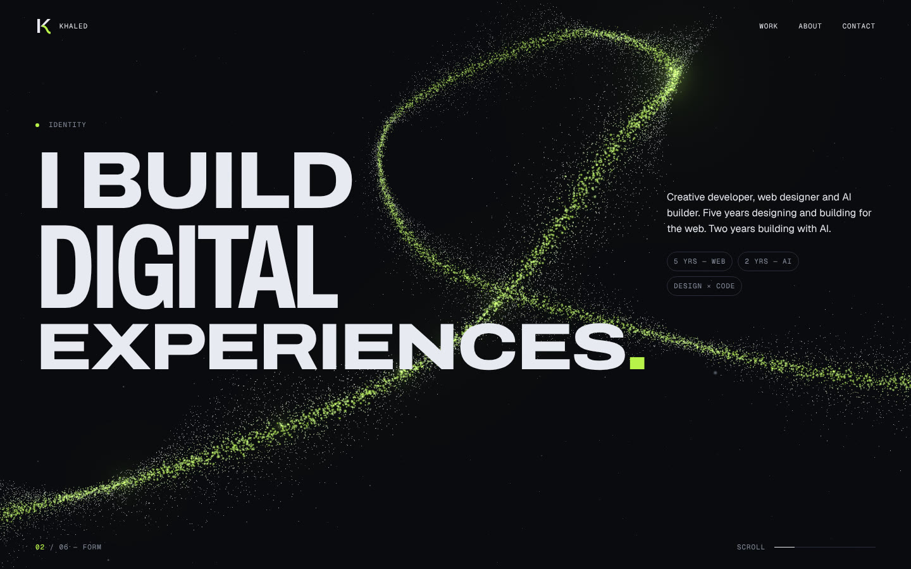
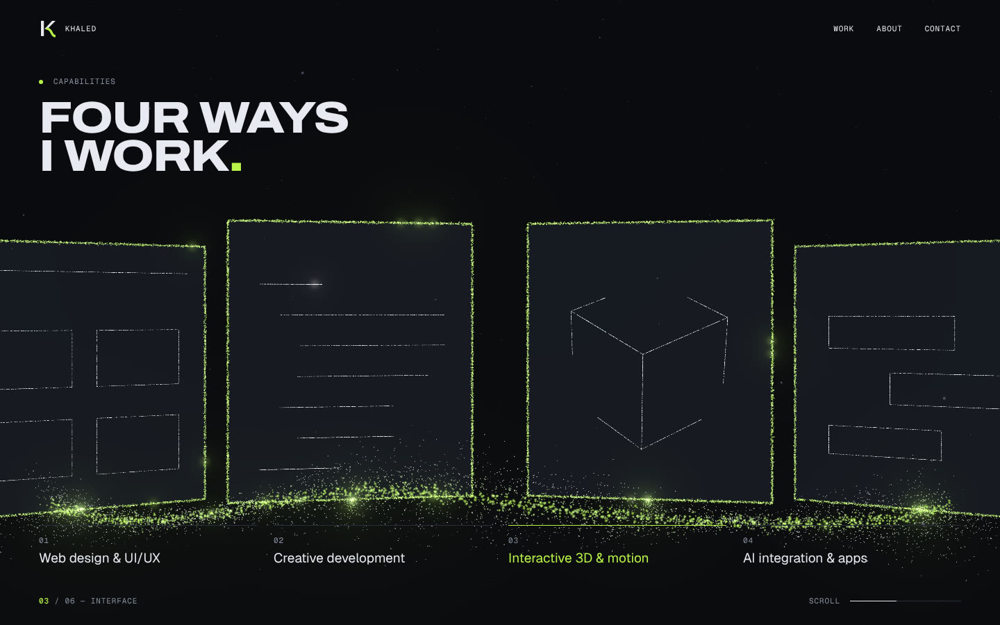
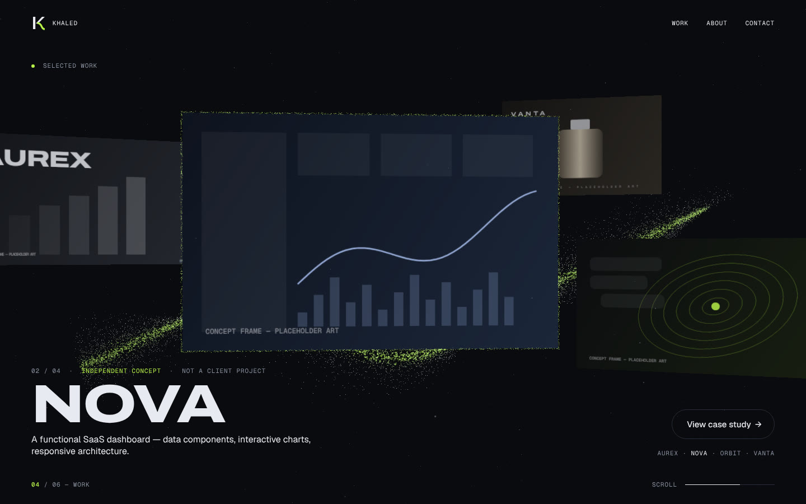
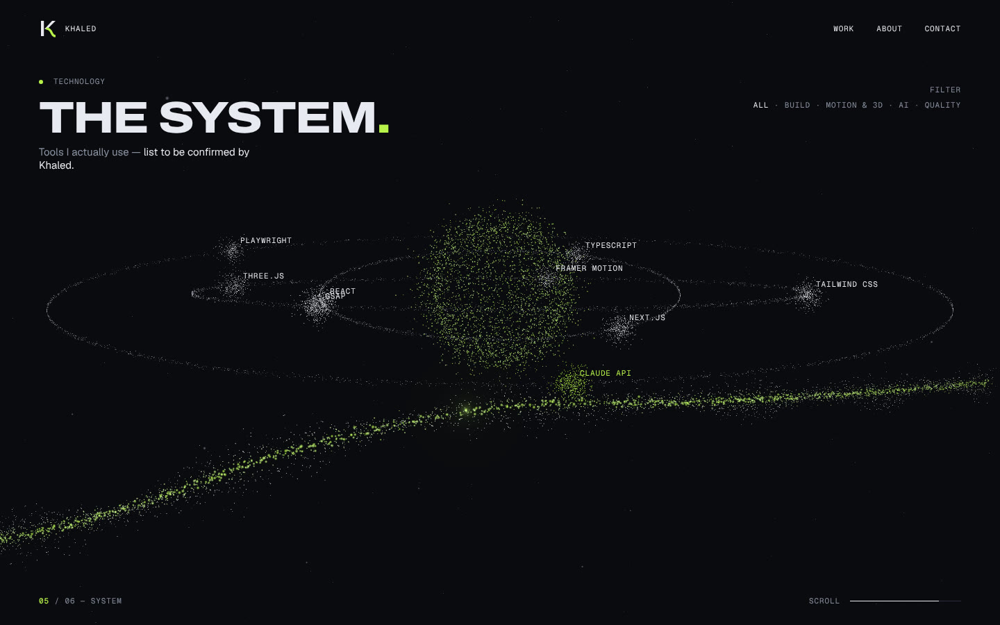
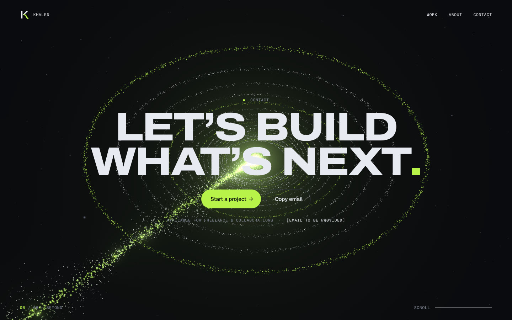

# Homepage Storyboard & Motion Specification

**Status:** proposal v1 · pairs with [art direction](../art-direction.md) and [technical plan](technical-plan.md)

## Global systems

| System | Spec |
|---|---|
| **Scroll** | Lenis (lerp 0.1) driven by `gsap.ticker`; ScrollTrigger owns chapter timelines. Total homepage length ≈ **10 viewport heights** on desktop, ≈ 8 on mobile. Native scroll under reduced motion and on touch. |
| **Chapter progress** | One master `progress ∈ [0,6]` written to a shared store (refs, not React state) by ScrollTrigger and read by the WebGL scene in `useFrame`. Everything is a **pure function of scroll**, so reversing, scrollbar drags, anchor jumps and reloading at depth always land on the correct frame. |
| **HUD** | A fixed chapter index (`01 / 06 — SIGNAL`) and a progress hairline. Updates on chapter enter: the label cross-fades (0.3s) and the numbers tick. |
| **Cursor** | Desktop pointer only. A 6px lime dot (`quickTo`, 0.35s, power3) plus a 36px silver ring trailing at 0.6s. States via `data-cursor`: `view` (the ring grows to 88px with a "View" label), `drag`, `link` (the ring hugs the target). The native cursor stays visible on text and inputs. |
| **Magnetic UI** | Primary/secondary buttons and nav links. The inner label translates toward the pointer by 30% of the offset within a 1.4× hit zone; it springs back on leave over 0.6s with `ease.flow`. The hit area itself never moves. |
| **Controlled glitch** | Only two triggers: project-title hover (Scene 04) and tool-filter change (Scene 05). RGB-split clones ±2px with 3 clip-path slices, 240ms total, once per trigger. Disabled under reduced motion. |
| **Page transitions** | Home → case study: the selected WebGL card plane scales to fill the viewport (0.9s `ease.cine`) while a View Transition morphs the DOM title. Case study → next project: the Flow line sweeps the screen as a wipe (0.7s). Back: an instant restore of scroll position, with no transition replay. |

**Motion tokens:** `ease.flow = cubic-bezier(.16,1,.3,1)` · `ease.cine = cubic-bezier(.65,0,.35,1)` · durations `.2 / .45 / .9 / 1.6s` · stagger `.06` items, `.08` lines, `.018` chars (display words ≤ 8 characters only).

---

## SCENE 01 — SIGNAL (opening) · 0 → 1.2 vh

**Story:** darkness, then signal. Scattered light gathers into a single ribbon, which threads through the name.
**Camera:** z 14, a slow push to z 12.5 across the scene. Pointer parallax ±0.25 units (damped λ 4).
**DOM (SSR, in the HTML):** `h1` "KHALED" (it becomes visually transparent once the WebGL wordmark takes over; still present for SEO, accessibility and LCP), the statement paragraph, and "Beyond the interface / Portfolio 2026".

| # | Element | Purpose | Trigger | Duration / ease | Exit state |
|---|---|---|---|---|---|
| 1.1 | Preloader veil (obsidian) + % counter (mono) | Masks shader compile and font load; first-visit only (session) | Page load | Until ready, **max 2.0s**; counter `snap 1` | Veil fades out over 0.6s; skipped on repeat visits |
| 1.2 | Particle gathering | Establish "signal → form" | Veil exit | 2.4s, per-particle delay 0–0.8s, `ease.flow` | Particles settled on the ribbon; the ribbon keeps flowing (idle) |
| 1.3 | Wordmark reveal (WebGL, in-depth) | The name *inside* the light | t = 0.9s into 1.2 | 1.1s; letters rise from a mask, stagger 0.05, `ease.flow` | Visible; the Flow passes behind K-H-A and in front of E-D |
| 1.4 | DOM crossfade | Swap the SSR `h1` for the WebGL wordmark seamlessly | WebGL wordmark ready | 0.3s | DOM `h1` at opacity 0 (stays in the accessibility tree) |
| 1.5 | Statement + meta lines | Positioning | t = 1.6s | 0.9s line reveals, stagger 0.08 | Static |
| 1.6 | Nav + HUD | Orientation | t = 1.9s | 0.45s fade | Fixed for the whole page |
| 1.7 | Ribbon idle flow | Life | Continuous | Particles advance along the curve, 1 loop / 14s | Continues until the scroll handoff |
| 1.8 | Scroll out | Hand off to Form | Scroll 0.6 → 1.2 vh (scrub) | — | Wordmark dissolves to particles that join the ribbon; text slides up 15% and fades |

**Reduced motion:** a static poster of this exact composition (pre-rendered), all text visible immediately, and no preloader.

## SCENE 02 — FORM (identity) · 1.2 → 2.6 vh

**Story:** the signal finds its shape. Kinetic typography states what he does.
**Camera:** drifts down and left 2 units, roll −3° (scrub).

| # | Element | Purpose | Trigger | Duration / ease | Exit state |
|---|---|---|---|---|---|
| 2.1 | Ribbon morph to a sweeping loop | Form = confidence | Scene enter (scrub) | Scrubbed over 0.6 vh | Loop holds |
| 2.2 | "I build" / "digital" / "experiences." | The statement | Each line at 85% viewport | 0.9s line mask reveal, stagger 0.12 | Static |
| 2.3 | Width flow on "digital" | Kinetic typography: wdth 125 → 62 as it enters | Scrub with 2.2 | Scrubbed | Holds at 62 (condensed, tall) |
| 2.4 | Lime period | The full stop is the cursor dot | After 2.2 | 0.45s scale 0 → 1 | Static, then a slow pulse every 4s (opacity 0.7 ↔ 1) |
| 2.5 | Bio paragraph + tags (5 yrs Web · 2 yrs AI) | Facts | 75% viewport | 0.9s, line stagger 0.08 | Static |
| 2.6 | Scroll out | Into Interface | Last 0.4 vh | Scrub | Type slides up and fades; the ribbon flattens into a horizontal "floor" |

## SCENE 03 — INTERFACE (capabilities) · 2.6 → 4.2 vh · *signature moment 2*

**Story:** the Flow becomes interfaces. The four ways he works, each built from light.
**Pinned** for 1.2 vh on desktop.

| # | Element | Purpose | Trigger | Duration / ease | Exit state |
|---|---|---|---|---|---|
| 3.1 | Ribbon splits into 4 streams | Flow → interface | Pin start (scrub) | Scrubbed 0 → 25% of the pin | The streams rise into the panel positions |
| 3.2 | Panel outlines draw | Interfaces assemble | 15 → 45% of the pin | Scrubbed; the edge particles travel along the perimeter | Lime-edged graphite panels in an arc |
| 3.3 | Interface glyphs form inside each panel | Shows each discipline: layout grid / code / 3D wireframe / chat | 35 → 70% of the pin | Scrubbed; particles morph from stream to glyph | Glyphs hold |
| 3.4 | Labels 01–04 + one-line descriptions | Readable content (DOM) | 60% of the pin | 0.6s, stagger 0.06 | Static |
| 3.5 | Panel hover | Explore a capability | Pointer enter (desktop) | Tilt toward the pointer ≤ 8°, lift z +0.4, edge brightness +40%, 0.45s `ease.flow`; the label turns lime | Returns over 0.6s on leave |
| 3.6 | Panel focus/click | Accessibility parity | Keyboard focus / click | Same as hover; click expands the description (DOM accordion) | Collapsed on blur/Esc |
| 3.7 | Exit | Into the work | Pin end | Scrub | The panels flip edge-on and dissolve into the ribbon, which dives into depth |

**Mobile:** no pin; a 2×2 grid of panels (frame m03), then a list. Panels animate once on enter (0.9s).

## SCENE 04 — WORK (projects) · 4.2 → 6.6 vh · *signature moment 3*

**Story:** proof. Four independent concepts floating in depth; the Flow is the light behind them.
**Camera:** dollies along z through the gallery (scrub), one project per 0.5 vh, snapping to labels.

| # | Element | Purpose | Trigger | Duration / ease | Exit state |
|---|---|---|---|---|---|
| 4.1 | Card planes (real captures of each build) | The work, large | Scene enter | The camera dolly is scrubbed; `snap` to each project (0.5s) | The active card is centred |
| 4.2 | Image reveal | Media appears from light | Card becomes active | 0.9s; a shader dissolve from particle noise to image | Image fully visible |
| 4.3 | Project title (DOM, Display L, wdth 125) | Identity | Active change | Chars scramble-in 0.5s (ScrambleText), then settle | Static |
| 4.4 | "Independent concept · Not a client project" label | Honesty, always visible | With 4.3 | 0.45s | Static; never hidden |
| 4.5 | Card hover | Interactive preview | Pointer over the active card | The cursor becomes "View"; the card tilts ≤ 6°; a looping 6s preview video plays inside the card | Pauses on leave |
| 4.6 | Title hover glitch | Punctuation | Hover on title | 240ms RGB split, once | Clean |
| 4.7 | Open case study | Signature transition | Click / Enter | 0.9s: the card scales to fullscreen plus a View Transition of the title | Case-study route |
| 4.8 | Index (Aurex · Nova · Orbit · Vanta) | Navigation | Always | The active item turns silver; others are muted | — |

**Mobile:** a horizontal scroll-snap carousel (native), cards as DOM images with a clip-path reveal; no WebGL cards.

## SCENE 05 — SYSTEM (technology) · 6.6 → 8.0 vh

**Story:** the system behind the work. Orbits of the tools he actually uses. **Honest and useful, not a logo cloud.**

| # | Element | Purpose | Trigger | Duration / ease | Exit state |
|---|---|---|---|---|---|
| 5.1 | Core + orbits form | The system | Scene enter (scrub) | Scrubbed 0.5 vh | Orbits rotate slowly (1 rev / 60s) |
| 5.2 | Tool nodes + mono labels | The real tool list (to be confirmed by Khaled) | After 5.1 | 0.45s, stagger 0.04 | Static labels |
| 5.3 | Filter (All · Build · Motion & 3D · AI · Quality) | Usefulness | Click/keyboard | Non-matching nodes dim to 20% over 0.45s; 240ms glitch on the label | Filter state persists |
| 5.4 | Node hover/focus | Detail | Pointer/focus | The node brightens; a tooltip shows "used for …" (one line, factual) | Hides on leave |
| 5.5 | DOM list mirror | Accessibility + SEO | Always present | — | Visually hidden on desktop; **the primary UI on mobile** (a filterable chip list) |

## SCENE 06 — BEYOND (contact) · 8.0 → 10 vh · *signature moment 4*

**Story:** the Flow becomes a portal. The camera moves toward it; the CTA waits at its centre.

| # | Element | Purpose | Trigger | Duration / ease | Exit state |
|---|---|---|---|---|---|
| 6.1 | Ribbon coils into a tunnel of rings | Portal | Scene enter (scrub) | Scrubbed 0.8 vh | Rings hold and rotate (1 rev / 40s, alternating direction) |
| 6.2 | Camera push into the portal | Anticipation | Scrub | Scrubbed z 12 → 7 | Holds |
| 6.3 | "Let's build what's next." | The ask (copy to be finalised with Khaled) | 80% viewport | 0.9s line reveal, wdth 100 → 118 on enter | Static |
| 6.4 | Radial scrim behind the CTA copy | Legibility over particles (found in mobile frame review) | With 6.3 | 0.6s | Static |
| 6.5 | Primary CTA "Start a project" (magnetic) | Conversion | Visible | Magnetic; on hover the portal core brightens +30% | Click → contact form (in-page dialog on desktop, `/contact` on mobile) |
| 6.6 | Copy email | Zero-friction contact | Click | The label swaps to "Copied ✓" for 2s | Restores |
| 6.7 | Availability line | Expectation | Static | — | Driven by one config value |
| 6.8 | Footer (socials, © , back to top) | Utility | Static | — | — |

**Form:** ≤ 4 fields (name, email, project type, message), inline validation, honeypot, a success state ("Thanks — I reply within 2 working days", to be confirmed), and a mailto fallback.

---

## Reduced-motion version (complete, not an afterthought)

- No Lenis, pins, parallax, scramble or glitch. The cursor is native.
- WebGL is replaced by **pre-rendered poster frames of each chapter** (the same pipeline that produced these concept frames), crossfaded at 200ms as chapters enter.
- All text is visible immediately. Transitions are instant or 200ms opacity only.
- Everything above stays reachable by keyboard and screen reader.

## Scroll budget summary (desktop)

| Scene | vh | Pinned |
|---|---|---|
| 01 Signal | 1.2 | no |
| 02 Form | 1.4 | no |
| 03 Interface | 1.6 | 1.2 |
| 04 Work | 2.4 | snap per project |
| 05 System | 1.4 | no |
| 06 Beyond | 2.0 | no |
| **Total** | **≈ 10** | |
