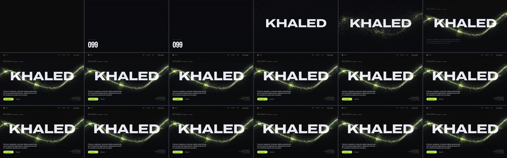
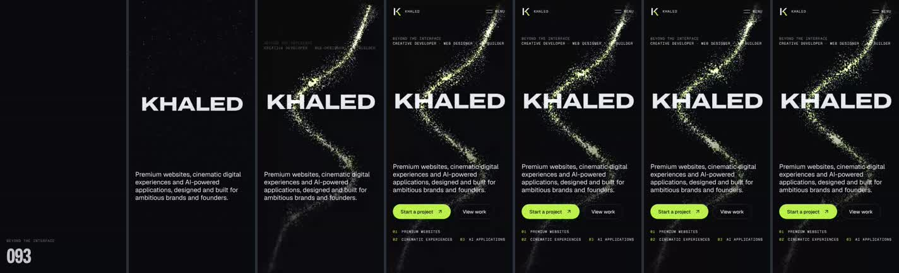

# Hero Review — awaiting Khaled's visual approval

**Status:** Phase 5 is **paused** until Khaled approves the Hero after reviewing it on real desktop and mobile devices. Nothing is published.
**Build:** `portfolio/` production build · branch `claude/portfolio-skills-setup-rwlc89`

## How to preview

See [`portfolio/README.md`](../../../portfolio/README.md). In short, with Node ≥ 20.9:

```bash
cd portfolio && npm install && npm run build && npm start
# → http://localhost:3000   (new tab/window = first-visit opening again)
```

## Review material

| File | What |
|---|---|
| `hero-desktop.mp4` | 1440×900, high tier: opening → cursor interaction → scroll-out *(sent directly, not in git)* |
| `hero-mobile.mp4` | 390×844, mobile tier: opening → scroll-out *(sent directly, not in git)* |
| `desktop-sequence.jpg`, `mobile-sequence.jpg` | Frame sequences of the recordings |
| `screenshots/hero-desktop-1440.jpg`, `hero-desktop-1920.jpg` | Settled hero, desktop |
| `screenshots/hero-tablet-768.jpg` | Settled hero, tablet portrait |
| `screenshots/hero-mobile-390.jpg`, `hero-mobile-360.jpg` | Settled hero, phones |
| `screenshots/hero-reduced-motion-1440.jpg` | Reduced-motion version |

> ⚠️ All captures were made in a cloud container **without a GPU** (software WebGL). Timing is real, but motion is choppier than on a real device. Please judge smoothness on your own machine.




## Decisions applied (2026-11-24)

1. **Mobile intro (approved):** the offer line is visible from the first frame, followed by the KHALED wordmark rise.
2. **Opening veil (changed):** no forced waiting screen. The black screen exits the moment the scene is ready and is fully gone **≤ 1.0s** after navigation, fade included; a CSS failsafe enforces the cap even if JavaScript is slow. The counter only appears if initialisation takes > 300ms. Measured:

| Scenario | Veil fully gone | Counter shown |
|---|---|---|
| Desktop, normal | 767 ms | briefly (software WebGL init > 300ms here) |
| Mobile, 4× CPU throttle | 859 ms | briefly |
| JavaScript disabled | never shown | — |
| Repeat visit | never shown | — |

On a device with a real GPU, initialisation is usually faster than 300ms, so most first visits won't see a counter at all.

## Verified on this build

- QA, home: 0 blocking issues at 360 / 390 / 768 / 1024 / 1440 / 1920 + reduced motion, axe-core included. Previous full sweep: 7 routes, 0 blocking.
- Lab LCP (local, unthrottled): 108–220 ms. The intro never delays LCP.
- Tablet-portrait legibility fixed in this round: the hero scrim now follows orientation, not width.

## Known issues (open)

1. **Real-device performance is unverified.** All frame-rate testing ran on software WebGL. Smoothness on real desktops and phones, and the auto-downgrade threshold (< 42 fps), need checking on your devices.
2. **Counter flash.** On slower devices the counter can appear for a fraction of a second before the veil exits. This is by design (it only shows when initialisation is genuinely slow), but it may read as a flicker; it can be removed entirely if you prefer a pure black screen.
3. **Safari/WebKit and Firefox are untested.** Only Chromium is installed in this environment.
4. **The wordmark scroll-out** lifts and drifts the letters toward the camera; it does not yet dissolve into particles as the storyboard describes (planned for Phase 5).
5. **The Flow behind Scenes 02–05** is functional but not yet aligned with their content: the ribbon crosses the Scene 02 bio, the panels and frame don't sit over the cards, and the orbits sit behind the tool table (Phase 5).
6. **Placeholders:** contact email, social links, availability line, OG/share images, real project captures; the tool list needs your confirmation.
7. **Console:** React Three Fiber 9.8 logs a known `THREE.Clock` deprecation warning (library-side, harmless).
